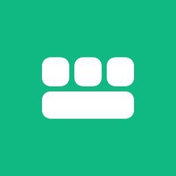
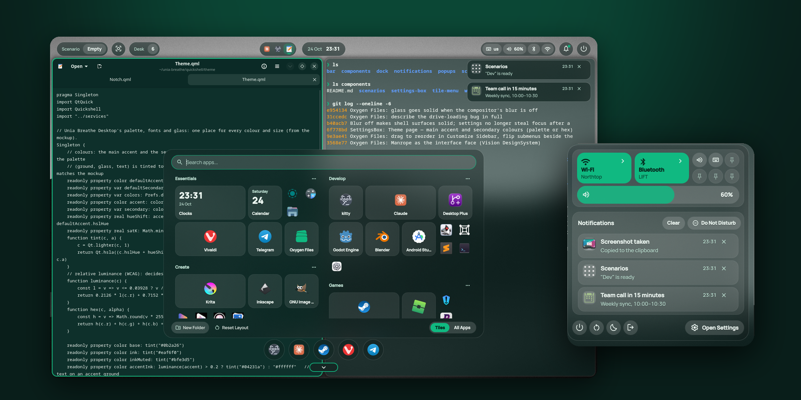
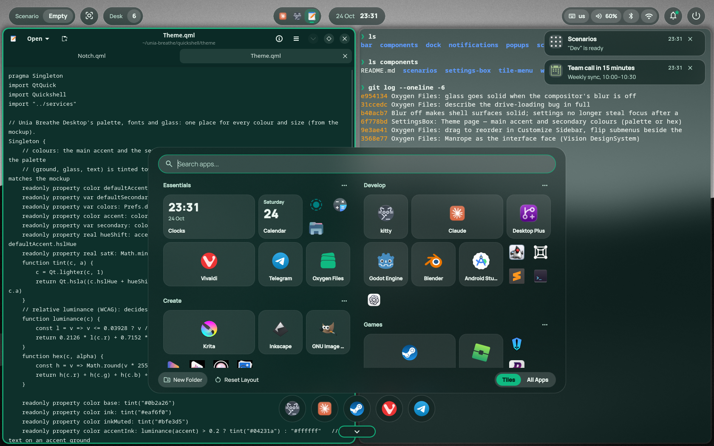
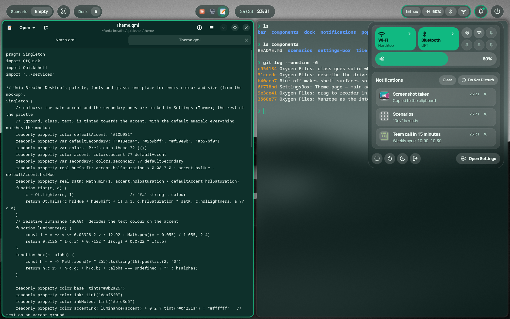
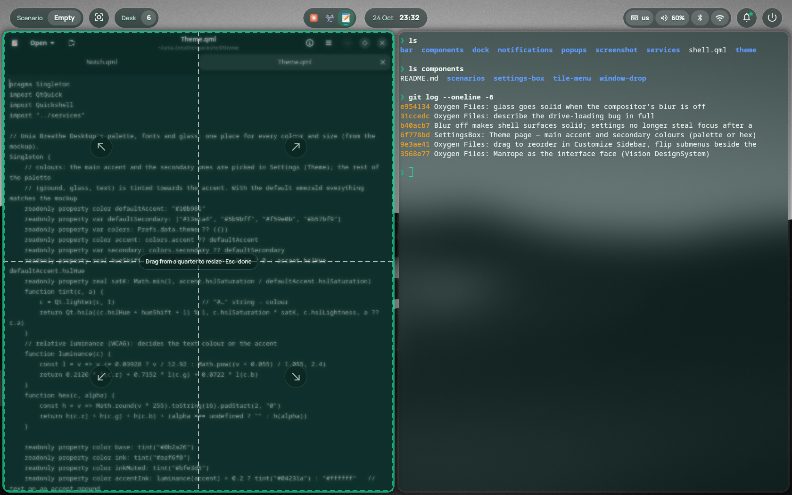
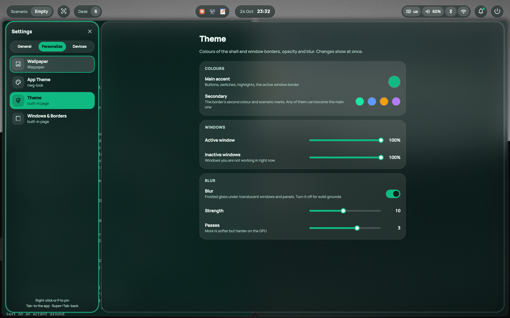
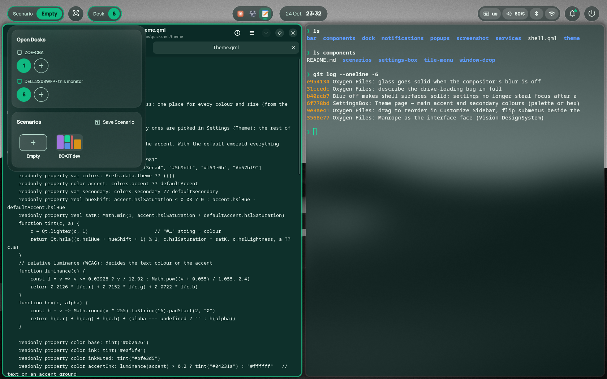
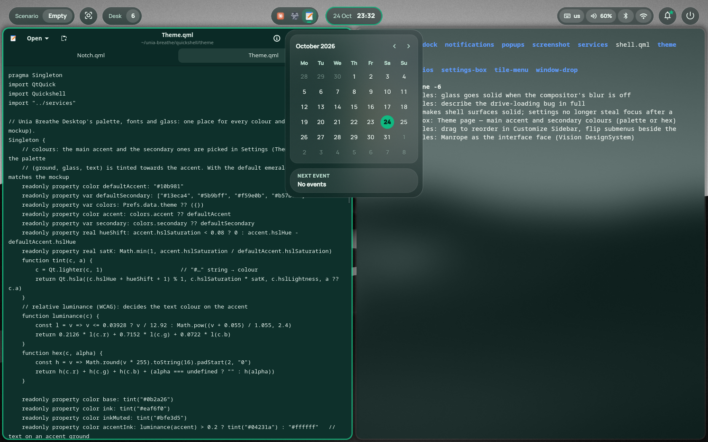
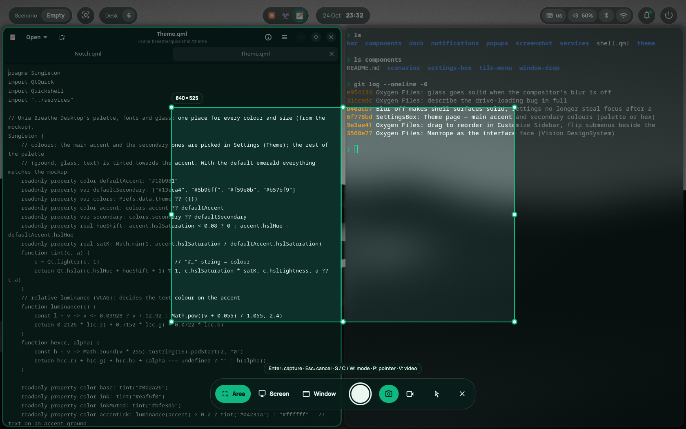

<p align="center">
  
</p>

<h1 align="center">Unia Breathe Desktop</h1>

<p align="center">
  A calm, glassy desktop shell for Hyprland, part of the Unia family.<br>
  Floating glass bubbles instead of a panel, a tile menu, a control centre, settings in their own space,<br>
  and windows you pick up by a drop in their border.
</p>

<p align="center">
  
</p>

**Built with:** Quickshell (QML) · **Runs on:** Hyprland 0.56+ · **Language:** English · **License:** MPL 2.0

---

## Why Unia Breathe Desktop

- **Room to breathe.** There is no solid panel. The top of the screen holds a few separate glass bubbles with the wallpaper between them, and the dock stays hidden until the cursor touches the bottom edge.
- **Where you expect it.** The clock is in the middle, status and power on the right, desks and scenarios on the left. Settings open with Super+I, the app menu with Super+R, screenshots with Print.
- **Windows you can hold.** Every window has a small drop in the middle of its top border. Bring the cursor close and it grows; drag it and the window shrinks to a square that follows you, while its neighbours already make room where it will land.
- **One accent, your choice.** Glass, text and ground are tinted from a single accent colour that you pick in Settings, with secondary colours for window borders and scenario marks.

## Features

### The top bar
- **Bubbles:** Scenario, Focus mode, Desk, the open windows, the clock, media, status, notifications, power
- **Status** shows the keyboard layout, volume, Bluetooth and Wi-Fi. Hover for details; scroll over volume to change it by 2 %, or over the layout to switch it
- **Clock** opens a month calendar with the next event from Google Calendar (read-only, through the calendar's secret iCal address)
- **Media** shows the cover and a scrolling title from any MPRIS player, with ⏮ ⏸ ⏭ and a media centre on click
- **Open windows** sit left of the clock: click to switch, middle-click to close, right-click to minimize or restore
- **Focus mode** (the round button left of the desk) turns the bar into one lower, solid strip

### TileMenu: the app menu
- A dock of five favourites, hidden until the cursor touches the bottom edge (as in Ubuntu)
- Folders of tiles in two columns. Tiles come in four sizes: small, medium, wide and large
- **Live tiles** show the clock, the next event or what is playing
- Drag tiles between folders, drag whole folders, drop between folders to make a new one
- Start typing to search; **All Apps** lists everything alphabetically

### Control centre
- Wi-Fi and Bluetooth tiles that expand into a list of networks (with a password field) or devices
- Six slots for pinned settings, a volume slider, and the power buttons, with Shut Down and Restart asking twice
- **Notifications** from our own server: history, actions, Do Not Disturb, and toasts in the corner of the focused monitor

### SettingsBox: settings in their own space
- Settings live on a special workspace that slides over your desk: a category panel on the left and the right app on the right, laid out as one window
- Apps you already know open in place (network, Bluetooth, sound, displays, wallpaper, printers…) and hide again when you move on
- **Built-in pages** for what has no app: Date & Time, Keyboard Layout, **Theme**, Windows & Borders, Mouse
- **Theme:** a main accent and four secondary colours, picked from a palette or typed as hex; window opacity; blur, which can be turned off for solid surfaces
- Fully usable from the keyboard: Tab, arrows, Enter, P to pin to the control centre, Esc to close

### WindowDrop
- A drop notch in the middle of each window's top border, deeper as the cursor gets closer, also on fullscreen windows
- **Drag** it (or hold Super and drag anywhere in the window) and the window becomes a square under the cursor. A translucent placeholder shows where it will land, and the neighbours shift to make room
- **Click** it for a menu: Minimize, Fullscreen, Float and Close, plus **Size** (a resize mode where a dashed cross splits the window into quarters) and **Desk** (hover for the desk list, click for the next desk)

### Desks and scenarios
- A scenario is a saved layout of windows. Open it and its apps launch and fall into place as they were
- The desk window shows open desks per monitor and scenario cards with a thumbnail of each layout

### Screenshots and screen recording
- **Print** freezes the screen and offers Area, Screen or Window, a screenshot or a video, with or without the pointer
- **Shift+Print** takes the whole screen, **Alt+Print** the focused window
- Shots are copied to the clipboard and saved to `Pictures/Screenshots`; videos go to `Videos/Screencasts`

### And around it
- A matching lock screen (hyprlock), GTK 3/4 and kitty palettes
- [**Oxygen Files**](https://github.com/BaraniukConnection/OxygenFiles), a file manager forked from Loaf, with the same glass (also in [`oxygen-files/`](oxygen-files))
- Fixes for two sleep problems on real hardware, in the [FAQ](docs/FAQ.md)

## Screenshots

| Desktop | App menu | Control centre |
|:-:|:-:|:-:|
|  |  |  |
| **WindowDrop** | **Resize mode** | **Settings · Theme** |
|  |  |  |
| **Desks and scenarios** | **Calendar** | **Screenshot picker** |
|  |  |  |

The interactive mockup the shell grew from is [`design/unia-breathe.html`](design/unia-breathe.html).

## Requirements

| | |
|---|---|
| **Required** | Hyprland 0.56 or newer, Quickshell 0.2.1 or newer, PipeWire, NetworkManager, the **Manrope** and **Material Symbols Outlined** fonts |
| **Screenshots** | grim, ImageMagick (`magick`), wl-clipboard, libnotify; wf-recorder for video |
| **Calendar** | Python 3 with `icalendar` and `python-dateutil` |
| **Lock and sleep** | hyprlock, hypridle |
| **Settings apps** | nm-connection-editor, pavucontrol, nwg-displays, nwg-look, waypaper, system-config-printer; optional Overskride, OpenRGB, OpenTabletDriver |
| **Theme** | adw-gtk3 for GTK 3 apps |

On Fedora:

```bash
sudo dnf install hyprland quickshell hyprlock hypridle grim ImageMagick wl-clipboard libnotify wf-recorder \
  python3-icalendar python3-dateutil nm-connection-editor pavucontrol nwg-displays nwg-look waypaper adw-gtk3-theme
```

The two fonts are not packaged in Fedora. Download the variable fonts
[Manrope](https://fonts.google.com/specimen/Manrope) and
[Material Symbols Outlined](https://github.com/google/material-design-icons/tree/master/variablefont), put the `.ttf` files
into `~/.local/share/fonts/` and run `fc-cache -f`.

## Install

```bash
git clone https://github.com/BaraniukConnection/unia-breathe-desktop ~/unia-breathe
cd ~/unia-breathe
./install.sh
```

`install.sh` only creates symlinks and is safe to run again. It:

- links the shell to `~/.config/quickshell/unia` (it runs as `qs -c unia`) and the scripts to `~/.local/bin`;
- links the lock screen to `~/.config/hypr/hyprlock.conf`;
- sets up the GTK 3/4 palette on top of adw-gtk3-dark and the kitty palette;
- adds `source = ~/unia-breathe/hypr/unia.conf` to `~/.config/hypr/hyprland.conf`. That file starts the shell, adds the blur and window rules, and sources the settings you change in the shell.

Then pick key bindings from [`hypr/binds.example.conf`](hypr/binds.example.conf) (or source it whole), copy [`hypr/hypridle.example.conf`](hypr/hypridle.example.conf) to `~/.config/hypr/hypridle.conf` if you want idle locking and sleep, and log in to Hyprland again.

### Google Calendar (optional)

In Google Calendar open **Settings for my calendars → Integrate calendar** and copy the **Secret address in iCal format**. Put it into `~/.config/unia-breathe/calendar.url`, one address per line. The file is outside the repository on purpose: the address gives read access to your calendar, like a password.

## Key bindings

These come from `hypr/binds.example.conf`.

| Keys | Action |
|---|---|
| **Super+R** | App menu |
| **Super+N** | Control centre and notifications |
| **Super+S** | Desks and scenarios |
| **Super+I** | Settings (Super+Tab goes back to the category panel) |
| **Super+M** | Minimize the window (click it on the bar to restore) |
| **Super+drag** | Move a window with WindowDrop |
| **Super+right-drag** | Resize a window |
| **Print** / **Shift+Print** / **Alt+Print** | Screenshot picker / whole screen / window |
| **Super+L** | Lock |

## Where things are kept

| File | What |
|---|---|
| `~/.config/unia-breathe/settings.json` | Shell settings: theme colours, focus mode, pinned settings, clock format |
| `~/.config/unia-breathe/hyprland.conf` | Hyprland options changed from Settings, generated from `settings.json` |
| `~/.config/unia-breathe/menu.json` | The dock favourites and the tile layout |
| `~/.config/unia-breathe/calendar.url` | Your secret iCal addresses (never in git) |
| `~/.config/hypr/scenarios/` | Saved scenarios, one JSON file each |

## Under the hood

- **Quickshell** (QML on Qt 6) draws everything: the bar is a set of layer-shell surfaces, popups share one layer under the bar, and Hyprland blurs every `unia-*` surface through a layer rule
- **Hyprland IPC** for windows, desks and options; options changed in Settings are applied live with `hyprctl keyword` and written to a config Hyprland sources last
- **WindowDrop** reads the cursor straight from Hyprland's socket while dragging and lets Hyprland's dwindle layout place the placeholder, so the preview matches where the window really lands
- **Scenarios** are saved by a small Python script that rebuilds the split tree of the windows

```
quickshell/
├── shell.qml          the root: bars, docks, popups, IPC targets
├── bar/               the top bar and its bubbles
├── dock/              the hidden dock
├── popups/            calendar, media centre, control centre, power menu, desks
├── notifications/     toasts
├── screenshot/        the screenshot picker
├── services/          audio, network, Bluetooth, media, notifications, windows, settings…
├── theme/             the palette, glass and shared controls
└── components/
    ├── tile-menu/     TileMenu
    ├── settings-box/  SettingsBox and its built-in pages
    ├── window-drop/   WindowDrop
    └── scenarios/     Scenarios and the unia-scenario script
bin/                   unia-calendar, unia-sleep, unia-shot-notify
hypr/                  Hyprland rules, the lock screen, example binds and idle config
gtk/, kitty/           palettes for GTK and kitty
system/                optional system fixes from the FAQ
oxygen-files/          the Oxygen Files file manager
```

Four components also live in their own repositories, each with a short README on using it in another Quickshell config:
[TileMenu](https://github.com/BaraniukConnection/unia-tile-menu),
[SettingsBox](https://github.com/BaraniukConnection/unia-settings-box),
[WindowDrop](https://github.com/BaraniukConnection/unia-window-drop) and
[Scenarios](https://github.com/BaraniukConnection/unia-scenarios).
[`quickshell/components/README.md`](quickshell/components/README.md) lists what each one needs from the shell.

## FAQ

[`docs/FAQ.md`](docs/FAQ.md) covers two problems met on real hardware, with ready files in [`system/`](system):

- the screen hangs after sleep with an NVIDIA card;
- a wireless keyboard or mouse dongle stops working after sleep.

## License

Unia Breathe Desktop is released under the [Mozilla Public License 2.0](LICENSE). You can use, modify and ship it, including inside larger projects; changes to its own files must stay open under the same license.

[Oxygen Files](https://github.com/BaraniukConnection/OxygenFiles) is a fork of [Loaf](https://github.com/m-uvex/loaf-fm) by m_uvex and keeps the upstream license (MIT, as stated in its README).

## Third-party

| | License |
|---|---|
| [Quickshell](https://quickshell.org) | LGPL 3.0 (used, not bundled) |
| [Manrope](https://github.com/sharanda/manrope) | SIL Open Font License 1.1 |
| [Material Symbols](https://github.com/google/material-design-icons) | Apache License 2.0 |
| [Loaf](https://github.com/m-uvex/loaf-fm) (Oxygen Files) | MIT |
