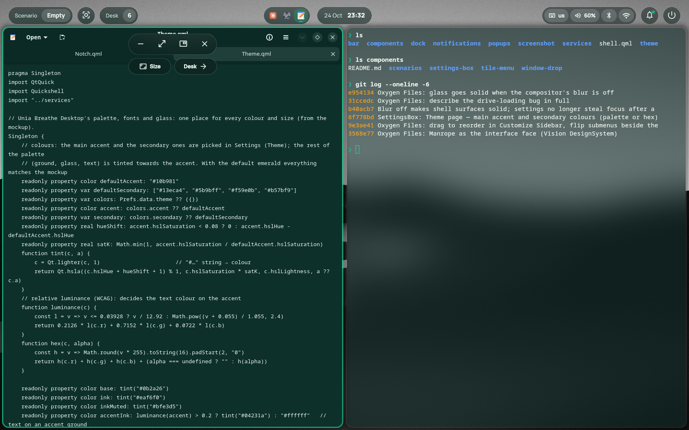

# WindowDrop

Pick up Hyprland windows by a drop in their border. A Quickshell component from [Unia Breathe Desktop](https://github.com/BaraniukConnection/unia-breathe-desktop).



- A small notch grows out of the middle of a window's top border as the cursor gets closer, also on fullscreen windows.
- **Drag** it, or hold Super and drag anywhere in the window. The window shrinks to a square under the cursor, and a translucent placeholder shows where it will land while the neighbours make room.
- **Click** it for Minimize, Fullscreen, Float and Close, plus **Size** (a resize mode split into quarters by a dashed cross) and **Desk** (move to another desk).

## Use it

It ships with Unia Breathe Desktop in `quickshell/components/window-drop`. To use it in your own Quickshell config, put this folder at `components/window-drop` and take `theme/`, `services/Windows.qml` and `services/Hypr.qml` from Unia Breathe Desktop. Then in `shell.qml`:

```qml
import "components/window-drop"

Variants { model: Quickshell.screens; WindowDrop {} }
DropPlace {}
IpcHandler {
    target: "drop"
    function menu(): void { const w = Windows.list.find(w => w.active && !w.minimized); if (w) Drops.openMenu(w.address) }
    function close(): void { Drops.closeMenu() }
    function grab(): void { Drops.grab() }
    function release(): void { Drops.release() }
}
```

Hyprland needs the placeholder rules (the `unia-drop-place` rule in [`hypr/unia.lua`](https://github.com/BaraniukConnection/unia-breathe-desktop/blob/main/hypr/unia.lua)) and, for Super+drag (`unia` is the config name; use yours):

```lua
hl.bind("SUPER + mouse:272", hl.dsp.exec_cmd("qs -c unia ipc call drop grab"))
hl.bind("SUPER + mouse:272", hl.dsp.exec_cmd("qs -c unia ipc call drop release"), { release = true })
```

## Files

| | |
|---|---|
| `Drops.qml` | State and actions: hover, menu, dragging, resizing |
| `WindowDrop.qml` | The layer drawn on each monitor |
| `Notch.qml` | The notch itself |
| `DropMenu.qml` | The menu |
| `DropPlace.qml` | The placeholder window Hyprland tiles while dragging |

Requires Hyprland 0.57+ (Lua config) and Quickshell 0.3.2+. It talks to Hyprland through `services/Hypr.qml`. Licensed under the [Mozilla Public License 2.0](LICENSE).
